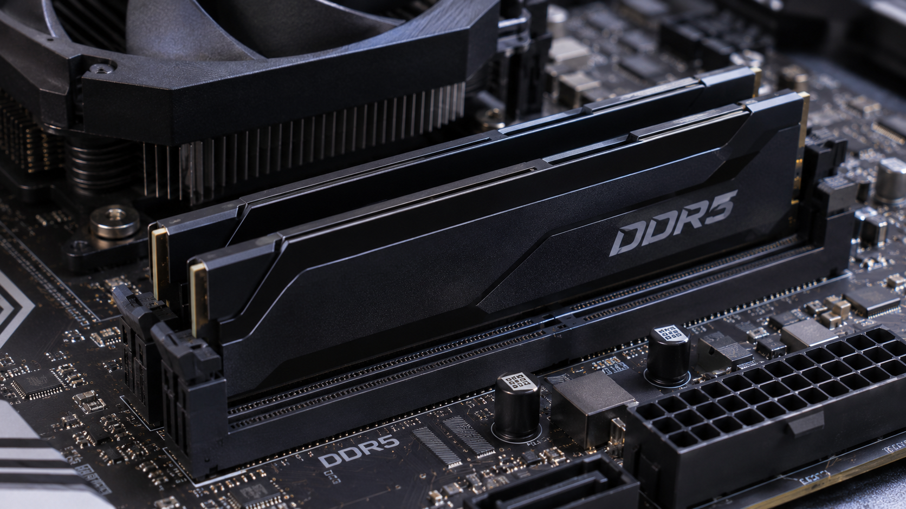
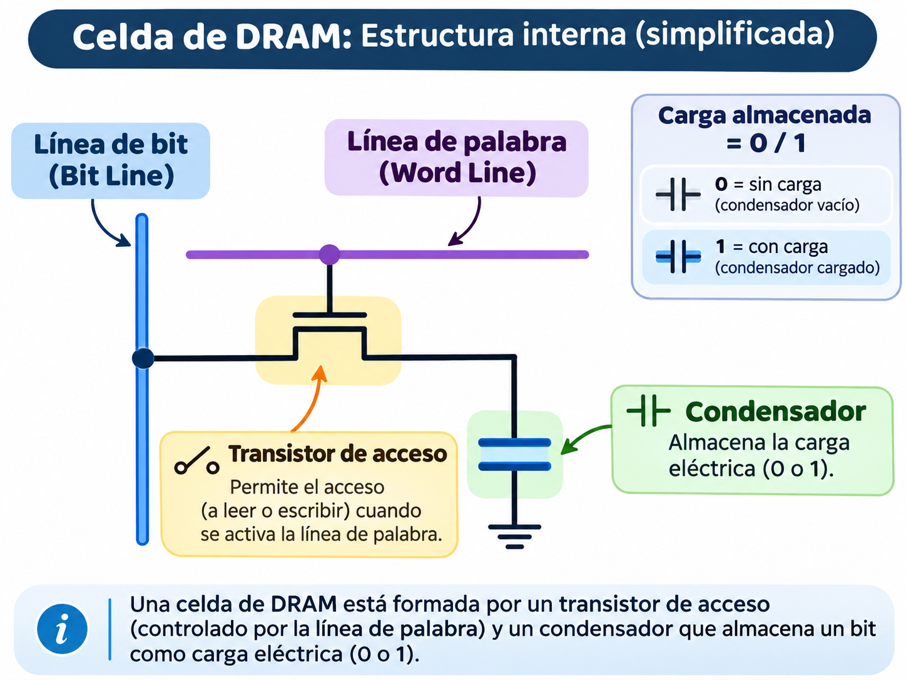
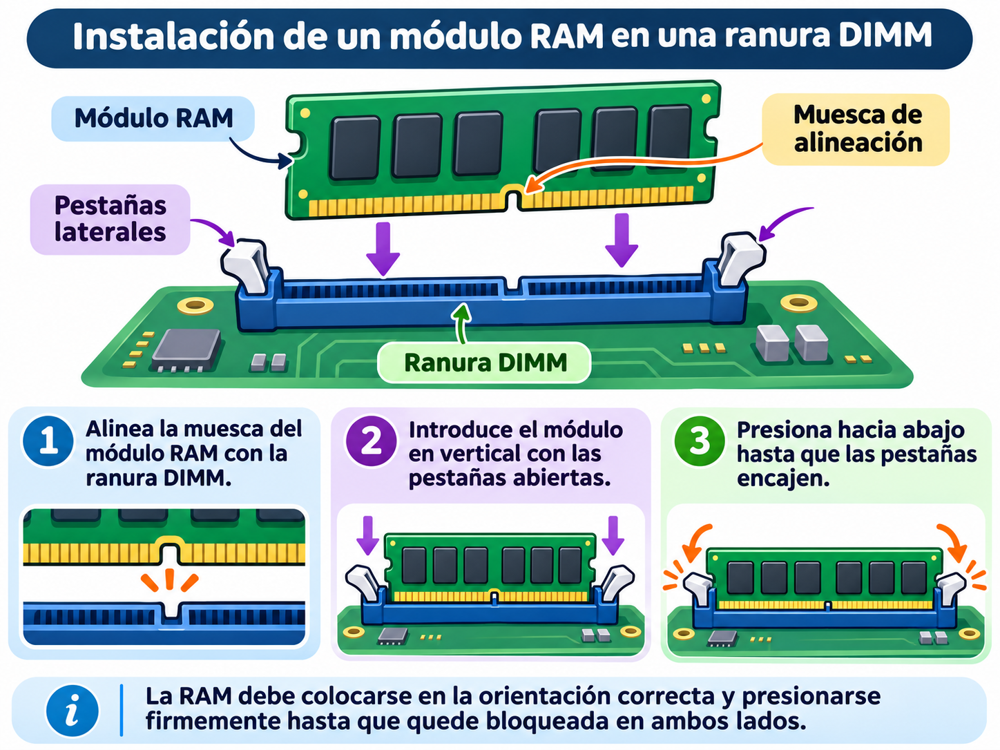

# Puzzle UT2 · Pieza 03: Memoria RAM

**Grupo:** Caleb Martín (@calebmartinc14) · Daniel Prades (@danipr1125)

## 1. Qué es y qué función cumple en el sistema

La **memoria RAM** (*Random Access Memory* o memoria de acceso aleatorio) es la memoria principal y volátil del ordenador. Guarda temporalmente el sistema operativo, los programas abiertos y los datos con los que la CPU está trabajando en ese momento.

Su función es actuar como un espacio de trabajo rápido: cuando abrimos una aplicación, esta se carga desde el disco —SSD o HDD— a la RAM, porque la RAM es mucho más rápida que cualquier almacenamiento permanente. Así, el procesador puede leer y escribir datos con muy poca espera.

Es **volátil** porque, al apagar o reiniciar el equipo, se pierde su contenido. No debe confundirse con el disco duro o SSD: el disco guarda archivos de forma permanente, mientras que la RAM solo conserva información mientras el equipo recibe energía.

Una RAM insuficiente provoca que el sistema use la memoria virtual en el disco, lo que reduce mucho el rendimiento. Por ejemplo, con 8 GB se puede navegar y trabajar con ofimática, pero editar vídeo, ejecutar máquinas virtuales o tener muchas pestañas abiertas puede saturar la memoria.

## 2. Cómo funciona por dentro

Una memoria RAM está formada por miles de millones de celdas de almacenamiento. Cada celda guarda un **bit**: un 0 o un 1. En la DRAM tradicional, cada bit se almacena en un condensador que puede estar cargado o descargado, acompañado de un transistor que permite leerlo y escribirlo.

Como los condensadores pierden carga con el tiempo, la RAM debe **refrescarse** constantemente. Por eso se llama DRAM: *Dynamic RAM*, memoria dinámica. Este refresco es automático y ocurre miles de veces por segundo.

Los bits se organizan en una matriz de **filas y columnas**. Para localizar un dato, el controlador de memoria indica una fila y una columna, como si fuera una coordenada. Después, los datos se transfieren al procesador a través del bus de memoria.

El proceso básico es:

1. La CPU solicita un dato mediante una dirección de memoria.
2. El controlador de memoria activa la fila correspondiente.
3. Se selecciona la columna donde está el dato.
4. El módulo envía los datos al procesador.
5. Si el dato se modifica, se vuelve a escribir en la RAM.

En DDR5, cada módulo usa dos subcanales independientes de 32 bits, en lugar de un único canal de 64 bits como DDR4. Esto mejora la eficiencia al acceder a los datos. Además, DDR5 incorpora un chip PMIC que gestiona la alimentación directamente en el módulo y añade ECC interno para corregir ciertos errores de datos.

## 3. Características, unidades y cómo se miden

| Característica | Unidad | Valores típicos hoy | Qué significa |
|---|---:|---|---|
| Capacidad | GB | 8, 16, 32 o 64 GB por equipo | Cantidad de datos que puede tener cargados a la vez. Más capacidad permite usar más programas simultáneamente. |
| Tipo de memoria | — | DDR4, DDR5 | Generación de la memoria. Cada generación cambia el conector, el voltaje y la velocidad. |
| Velocidad de transferencia | MT/s | DDR4: 2133–3200 MT/s; DDR5: 4800–6400 MT/s o más | Número de transferencias por segundo. En DDR, “doble tasa de datos” significa dos transferencias por ciclo de reloj. |
| Ancho de banda | GB/s | DDR5-5600: unos 44,8 GB/s por módulo | Cantidad de datos que puede moverse por segundo. Se calcula a partir de la velocidad y el ancho del bus. |
| Latencia CAS | Ciclos de reloj | CL30, CL36, CL40, CL46 | Número de ciclos que tarda la RAM en responder tras recibir una orden de lectura. Menor valor suele indicar mayor rapidez. |
| Timings | Ciclos | Por ejemplo, 40-40-40 | Series de tiempos internos: CAS Latency, RAS to CAS Delay y RAS Precharge Time. |
| Voltaje | V | DDR4: 1,2 V; DDR5: 1,1 V base | Energía necesaria para funcionar. Menor voltaje reduce el consumo y el calor. |
| Formato | — | UDIMM, SO-DIMM | UDIMM se usa en sobremesa; SO-DIMM, más pequeña, en portátiles. |
| Canales | — | 1, 2, 4 canales | Número de rutas independientes entre RAM y CPU. Dos módulos pueden activar doble canal y mejorar el rendimiento. |
| ECC | — | ECC / no ECC | Capacidad de detectar y corregir errores. Es habitual en servidores; los equipos domésticos normalmente usan RAM no ECC. |

Para medir el rendimiento real se usan programas como **CPU-Z**, **HWiNFO**, **AIDA64** o **MemTest86**. Estos permiten comprobar la frecuencia, los timings, el modo de canal y la estabilidad de la memoria.

## 4. Tipos, evolución y estándares actuales

La evolución principal de la RAM de consumo ha pasado por las generaciones DDR:

| Generación | Año aproximado | Velocidad habitual | Voltaje | Cambio principal |
|---|---:|---:|---:|---|
| DDR | 2000 | 200–400 MT/s | 2,5 V | Primera memoria de doble tasa de datos. |
| DDR2 | 2003 | 400–800 MT/s | 1,8 V | Mayor velocidad y menor consumo. |
| DDR3 | 2007 | 800–2133 MT/s | 1,5 V | Más capacidad y eficiencia energética. |
| DDR4 | 2014 | 2133–3200 MT/s | 1,2 V | Mayor densidad y mejor rendimiento. |
| DDR5 | 2021 | 4800–6400 MT/s o más | 1,1 V | Dos subcanales, PMIC en el módulo, ECC interno y mayores capacidades. |

Los estándares actuales más relevantes son:

- **DDR5**: es el estándar actual en PCs nuevos. Ofrece mayores velocidades y capacidades por módulo que DDR4. 
- **DDR4**: sigue siendo muy común en equipos no muy antiguos. Es compatible solo con placas y procesadores que admitan DDR4.
- **LPDDR5 / LPDDR5X**: versiones de bajo consumo usadas sobre todo en portátiles delgados, móviles y tabletas. Normalmente van soldadas a la placa.
- **GDDR6 / GDDR6X**: memorias diseñadas para tarjetas gráficas, optimizadas para un ancho de banda muy alto.
- **ECC UDIMM / RDIMM**: memorias con corrección de errores usadas en servidores y estaciones de trabajo profesionales.

No se puede mezclar DDR4 y DDR5 en el mismo equipo: los conectores, señales y controladores son diferentes.

## 5. Un modelo real: ficha técnica interpretada

**Modelo:** Kingston FURY Beast DDR5 16 GB, 5600 MT/s, CL40  
**Referencia:** KF556C40BB-16  
**Enlace a la ficha del fabricante:** <https://www.kingston.com/es/memory/gaming/kingston-fury-beast-ddr5-memory>

| Dato de la ficha | Qué significa | ¿Es bueno? ¿Para qué uso? |
|---|---|---|
| Capacidad: 16 GB | El módulo puede almacenar 16 gigabytes de datos temporales. | Sí. Es adecuado para ofimática, navegación, programación y juegos actuales. Para edición de vídeo o máquinas virtuales, 32 GB es más recomendable. |
| Tipo: DDR5 | Es memoria de quinta generación de doble tasa de datos. | Sí. Es el estándar actual para equipos nuevos, aunque exige una placa base compatible. |
| Velocidad: 5600 MT/s | Realiza 5600 millones de transferencias por segundo. Equivale a PC5-44800. | Es una velocidad buena y muy habitual en DDR5. Aporta un rendimiento sólido sin necesidad de configuraciones extremas. |
| Latencia CAS: CL40 | Tarda 40 ciclos de reloj en empezar a entregar un dato tras una orden de lectura. | Es correcta para DDR5-5600, aunque no es la más baja del mercado. Para juegos y uso general es suficiente; para competición o tareas muy sensibles a latencia, CL30–CL36 puede ser mejor. |
| Timings: 40-40-40 | CAS Latency, RAS to CAS Delay y RAS Precharge Time son 40 ciclos. | Son valores estándar para este modelo. Indican una configuración estable, no extrema. |
| Voltaje: 1,25 V con XMP | Con el perfil XMP activado, el módulo funciona a 1,25 V para alcanzar 5600 MT/s. | Es un consumo bajo y razonable. Sin activar XMP, puede funcionar a 4800 MT/s y 1,1 V según el perfil JEDEC. |
| Formato: DIMM de 288 pines | Es un módulo para ordenador de sobremesa. | Correcto para torres y placas base ATX, micro-ATX o mini-ITX compatibles con DDR5. |
| Perfil Intel XMP 3.0 | Permite activar automáticamente la velocidad y latencias optimizadas desde la BIOS/UEFI. | Útil si la placa base y el procesador lo admiten. Sin activarlo, la RAM puede arrancar a una velocidad menor. |
| Formato unbuffered | Es memoria sin registros intermedios, habitual en PCs domésticos. | Correcto para uso personal. No es el tipo usado normalmente en servidores. |

**Valoración:** es una memoria equilibrada para un PC de sobremesa actual. Sus 16 GB y 5600 MT/s son adecuados para estudiar, programar, navegar, jugar y realizar tareas multimedia ligeras. Si el presupuesto lo permite, comprar un kit de dos módulos de 8 GB permite usar doble canal.

## 6. Averías típicas y errores al elegirla o instalarla

### Averías frecuentes

- **El equipo no arranca o emite pitidos:** puede deberse a un módulo mal insertado, incompatible o dañado.
- **Pantallazos azules o reinicios aleatorios:** una RAM inestable, con errores, puede provocar fallos del sistema.
- **Errores de memoria en pruebas:** si MemTest86 detecta errores, el módulo puede estar defectuoso o mal configurado.
- **El equipo detecta menos memoria de la instalada:** puede ocurrir por una ranura dañada, un módulo mal reconocido o una limitación de la placa base.
- **Rendimiento inferior al esperado:** puede pasar si los perfiles XMP/EXPO no están activados o si la RAM funciona en un solo canal.

### Errores al elegirla

- Comprar DDR5 para una placa base que solo admite DDR4, o al contrario.
- No comprobar la velocidad máxima admitida por la placa base y el procesador.
- Elegir SO-DIMM para un sobremesa o UDIMM para un portátil.
- Instalar un solo módulo cuando la placa admite doble canal.
- Mezclar módulos de distinta velocidad, capacidad o fabricante sin comprobar compatibilidad.
- Pagar por frecuencias muy altas que la placa base o el procesador no pueden aprovechar.

### Errores al instalarla

- No descargar la electricidad estática antes de manipular los módulos.
- Forzar el módulo en una ranura incorrecta.
- No escuchar el “clic” de las pestañas laterales al encajarlo.
- Colocar los módulos en ranuras que no activan doble canal.
- No activar XMP o EXPO en la BIOS tras instalar una RAM de alta velocidad.

## 7. Fuentes

- Kingston Technology. *Memoria Kingston FURY Beast DDR5*. <https://www.kingston.com/es/memory/gaming/kingston-fury-beast-ddr5-memory> 
- Kingston Technology. *DDR4 vs DDR5 DRAM: Las diferencias en rendimiento, compatibilidad y soporte de la plataforma*. <https://www.kingston.com/unitedkingdom/es/blog/pc-performance/ddr-memory-generation-differences> 
- SHI. *Kingston FURY Beast DDR5 KF556C40BB-16: especificaciones técnicas*. <https://www.uk.shi.com/product/44229087/Kingston-FURY-Beast-DDR5> 
- LDLC. *Kingston FURY Beast 16 GB DDR5 5600 MHz CL40 — ficha técnica*. <https://www.ldlc.com/es-es/ficha/PB00475594.html> 
- Crucial. *Crucial 16GB DDR5-5600 SODIMM CT16G56C46S5*. <https://www.crucial.com/memory/ddr5/ct16g56c46s5> 

## Uso de IA

**Qué preguntamos a Jarvis u otra IA:**

- “Explícame qué es la memoria RAM y cuál es su función en un ordenador.”
- “¿Cómo funciona una celda DRAM por dentro?”
- “¿Qué significan la frecuencia, la latencia CAS y los timings de una RAM?”
- “¿Cuáles son las diferencias entre DDR4 y DDR5?”
- “Interpreta la ficha técnica de la Kingston FURY Beast DDR5 16 GB 5600 MT/s CL40.”
- “¿Qué averías puede tener una memoria RAM y qué errores comunes hay al instalarla?”

**Cómo comprobamos sus respuestas:**

1. **Contrastamos con fuentes oficiales:** consultamos la página de Kingston para verificar capacidades, velocidades, latencias, voltajes y compatibilidad del modelo elegido. 
2. **Comprobamos datos técnicos en fichas independientes:** usamos fichas de distribuidores como SHI y LDLC para confirmar la referencia, el formato DIMM de 288 pines, el CL40 y los timings 40-40-40. 
3. **Verificamos afirmaciones generales:** comparamos las diferencias DDR4/DDR5 con un artículo técnico de Kingston, comprobando velocidad, voltaje, subcanales, longitud de ráfaga y ECC interno. 
4. **Descartamos respuestas sin fuente o demasiado genéricas:** si la IA decía “la RAM es muy rápida” sin explicar por qué, buscamos el dato concreto: la RAM es más rápida que el SSD porque está diseñada para acceso directo y continuo por parte de la CPU.
5. **Revisamos coherencia técnica:** por ejemplo, confirmamos que DDR5 no es compatible con DDR4 y que una velocidad de 5600 MT/s equivale a PC5-44800. 
